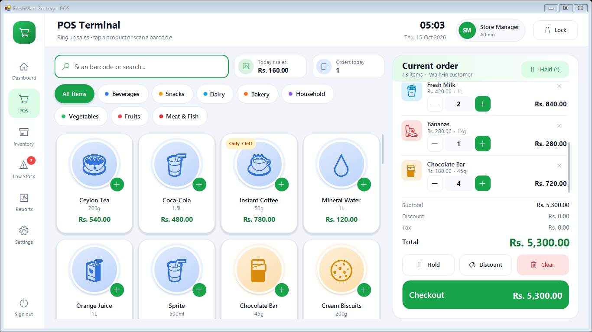
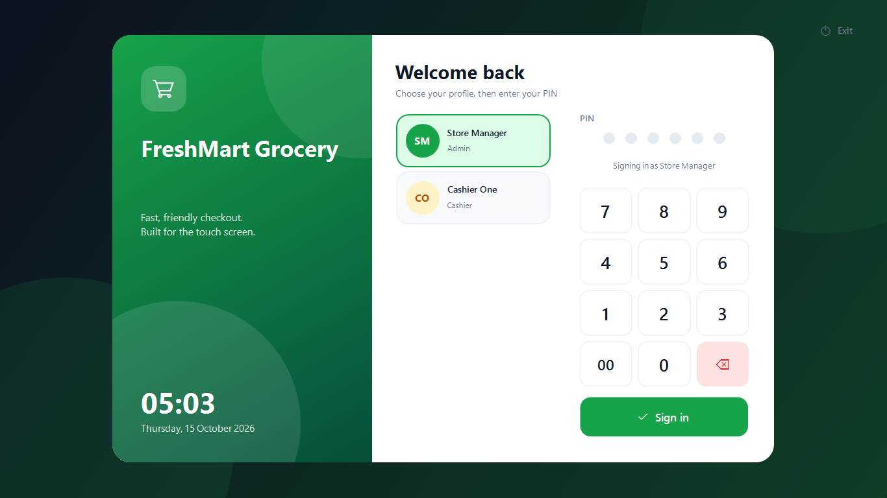
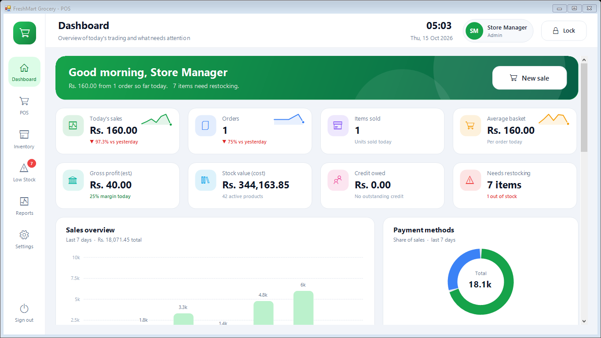
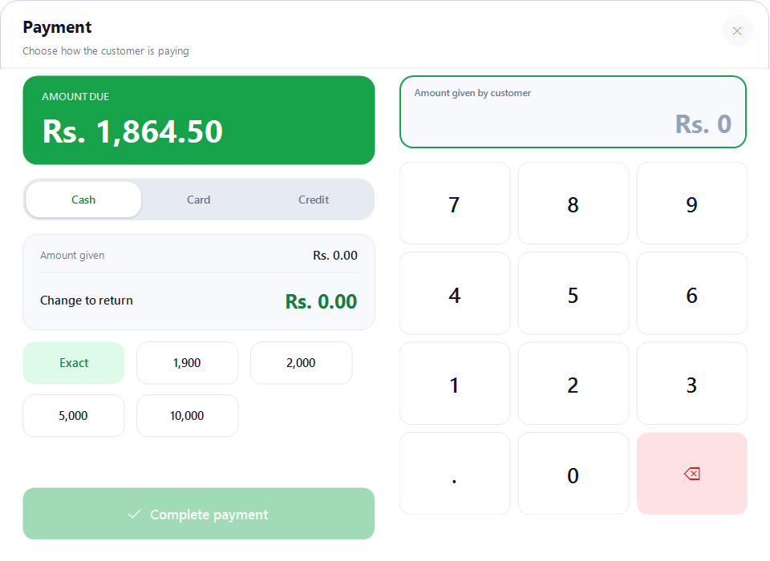
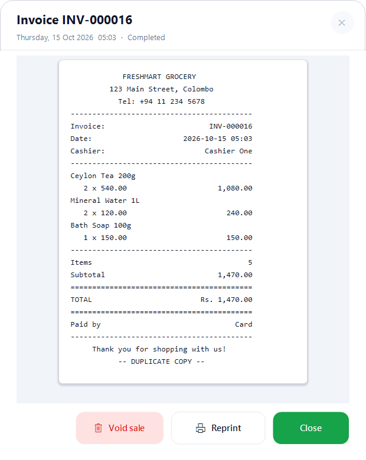
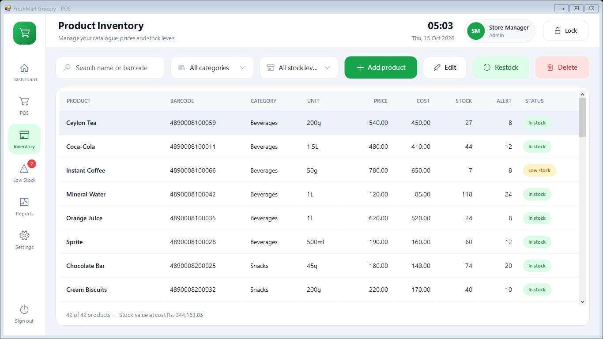
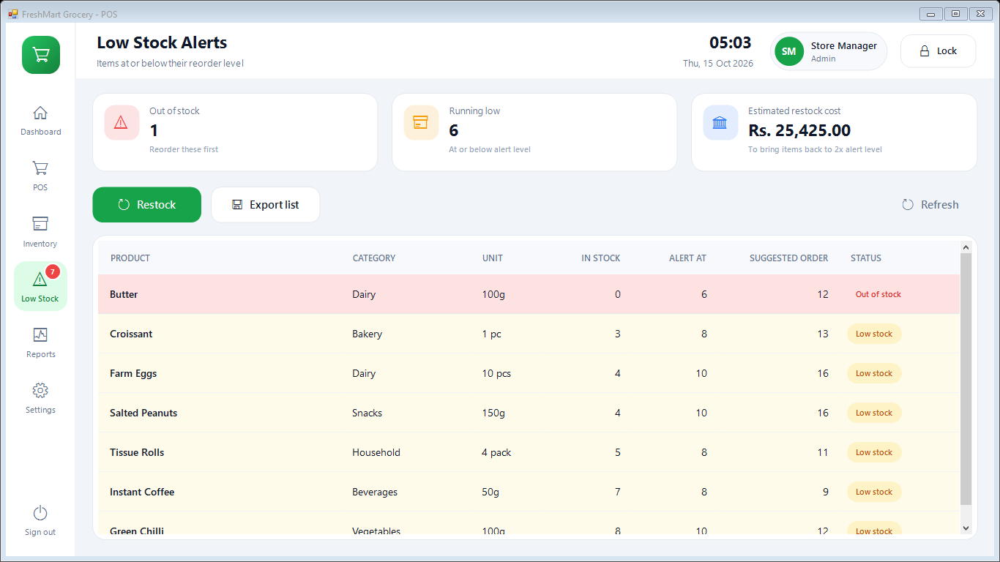
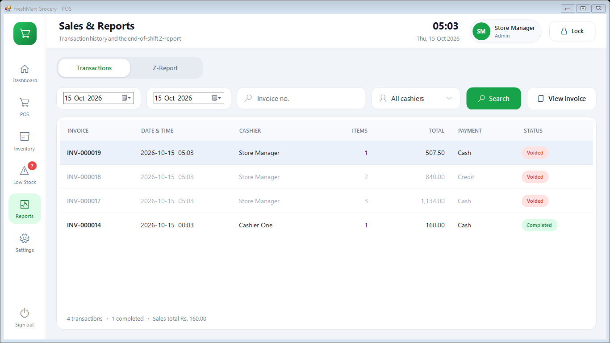
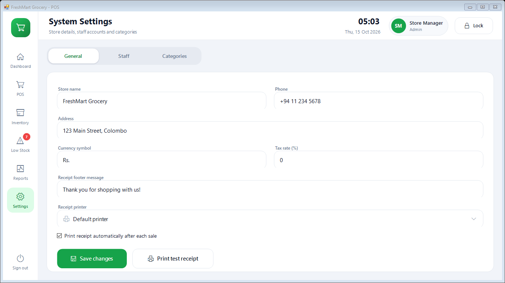

<div align="center">

# 🛒 FreshMart Grocery POS

**A modern, touch-first point-of-sale system for supermarkets and grocery stores.**


</div>

<p align="center">
  
</p>

## Overview

FreshMart Grocery POS is a desktop checkout and store-management application built with **C# / WinForms** on **.NET Framework 4.8** and **SQL Server Express**. It is designed for touch screens and barcode scanners: large tap targets, a PIN-pad login, and a fully custom-drawn, modern interface (no third-party UI libraries).

The whole system has **zero NuGet dependencies** and creates and seeds its own database on first launch.

## Features

| Area | Highlights |
|------|------------|
| **POS Terminal** | Category pills, tap-to-add product cards, live cart with quantity steppers, barcode scanning and search, hold / recall orders, percentage or fixed discounts |
| **Payments** | Cash (quick amounts and change calculator), card, and store credit linked to a customer account; receipt prints automatically |
| **Weighed items** | Sell by weight (e.g. meat, produce) with per-kg pricing; stock is tracked in grams |
| **Inventory** | Add, edit, restock and delete products; photo or emoji icon; per-item low-stock threshold |
| **Low-stock alerts** | Red/amber status, sidebar badge, and CSV export of a reorder list |
| **Reports** | Sales history with date, invoice and cashier filters; view, reprint and void invoices (voids restore stock); daily **Z-report** by cash / card / credit, discounts, tax and voids |
| **Dashboard** | Sales KPIs and trends at a glance for managers |
| **Settings** | Store details, currency, tax rate, receipt footer, printer, staff and categories |
| **Security** | Role-based access (Admin / Cashier); PINs stored as PBKDF2 hashes with random salts |
| **Receipts** | 80 mm thermal format (42 columns) via `System.Drawing.Printing` |

## Screenshots

<table>
  <tr>
    <td><br><sub><b>PIN-pad login</b></sub></td>
    <td><br><sub><b>Dashboard</b></sub></td>
  </tr>
  <tr>
    <td><br><sub><b>Payment</b></sub></td>
    <td><br><sub><b>Receipt</b></sub></td>
  </tr>
  <tr>
    <td><br><sub><b>Inventory</b></sub></td>
    <td><br><sub><b>Low-stock alerts</b></sub></td>
  </tr>
  <tr>
    <td><br><sub><b>Reports and Z-report</b></sub></td>
    <td><br><sub><b>Settings</b></sub></td>
  </tr>
</table>

## Tech Stack

- **Language / UI:** C#, Windows Forms (owner-drawn GDI+ controls, touch inertia scrolling)
- **Runtime:** .NET Framework 4.8
- **Database:** SQL Server Express via ADO.NET (parameterised queries, transactional checkout)
- **Build:** SDK-style `.csproj`, `dotnet build`

## Getting Started

### Prerequisites

- Windows 10 / 11
- [.NET SDK](https://dotnet.microsoft.com/download) (to build) and the .NET Framework 4.8 runtime
- SQL Server Express with the default `.\SQLEXPRESS` instance running

### Build and run

```bash
git clone https://github.com/angiedazun/freshmart-grocery-pos.git
cd freshmart-grocery-pos
dotnet build -c Release
bin\Release\net48\GroceryPOS.exe
```

On first launch the `GroceryPOSDB` database is created and seeded with sample categories, products, staff and customers.

To use a different SQL Server instance or database name, edit `GroceryPOS.exe.config` (or `App.config` before building):

```xml
<appSettings>
  <add key="SqlServer" value=".\SQLEXPRESS" />
  <add key="Database"  value="GroceryPOSDB" />
</appSettings>
```

### Demo sign-in

| Profile | PIN | Access |
|---------|-----|--------|
| Store Manager | `1234` | Everything |
| Cashier One | `1111` | POS, Low Stock, own sales history and Z-report |

> These are seeded **demo** credentials. Change them under **Settings → Staff** before any real use.

### Keyboard shortcuts

| Key | Action |
|-----|--------|
| `F2` | Focus the scan / search box |
| `F12` | Open checkout |

## Project Structure

```
GroceryPOS/
├── Data/            Database access and schema / seed data (auto-created)
├── Models/          Domain models
├── Services/        Business logic: sales, products, auth, receipts, settings
├── UI/
│   ├── Controls/    Custom-drawn controls (buttons, product grid, cart, numpad…)
│   ├── Dialogs/     Payment, discount, weight, customer picker, admin dialogs
│   └── Panels/      Dashboard, POS, Inventory, Low Stock, Reports, Settings
├── docs/screenshots Images used in this README
├── Program.cs       Entry point
└── GroceryPOS.csproj
```

## Quality and Testing

Debug builds include a built-in snapshot and self-test mode:

```bash
dotnet build -c Debug
bin\Debug\net48\GroceryPOS.exe --snap docs\screenshots
```

This renders every screen and dialog to PNG and runs a **27-check sales-logic self-test** against a throw-away database (checkout transactions, stock guards, voids restoring stock, weighed-item maths, 42-column receipt formatting). It is not compiled into Release builds.

## Roadmap

- [ ] Multi-terminal support with a central database
- [ ] Loyalty points and customer purchase history
- [ ] Supplier and purchase-order management
- [ ] Export reports to PDF / Excel
- [ ] Installer package

## License

Released under the [MIT License](LICENSE).

## Author

**Anjana Dasun Dissanayake** · [@angiedazun](https://github.com/angiedazun)
